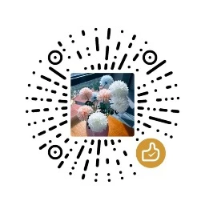

# [Typecho Harmony Hues](https://www.biibii.cn/ "Harmony Hues 主题")（和谐色调）主题


## 介绍

Typecho 主题《HarmonyHues - 和谐色调》，一款 **轻拟态（Soft UI）** 风格的轻量主题。

- 设计灵感源自自然界中的和谐之美：低对比的灰白底色、柔和的单向光源、卡片像从页面里轻轻浮起，而不是贴在上面。
- 名字来自当年让 GPT 起的几个候选，百度翻译「和谐色调」后顺手选中，后来懒得改了，就用这个主题名称
- 开发初衷很简单：阅读优先、少一点打扰、把「写」和「读」这件事做顺。

主题预览：[BIIBII.CN](https://www.biibii.cn/) ｜ 主题介绍：[关于主题](https://www.biibii.cn/harmonyhues.html)

## 亮点

- **轻拟态视觉系统**：全部颜色、圆角、阴影走 CSS 变量，改一处即可整体换肤；卡片有白边、内层渐变与双向阴影。
- **双模式导航**：全宽沉浸式 / 居中 Mini 式两种形态，滚动后自动收起为紧凑态，下滚隐藏、上滚即现，底部还有一条阅读进度线。
- **封面即标题**：文章封面可开关；开启时封面变成一张通栏「封面卡」，面包屑、标题、作者、时间、浏览、评论全部收进图内，正文卡片从内容直接开始。
- **阅读流导航**：上一篇 / 下一篇合并成一张卡，中间虚线加圆点，悬停时主色线从两侧展开。
- **零插件**：代码高亮、邮件提醒、表情包、友情链接、Sitemap、热力图、目录、灯箱全部内置，装好即用。

## 功能

**布局与外观**

- 自适应布局，PC / 平板 / 手机三端适配
- 单栏 / 双栏（带侧栏）排版切换
- 深色、浅色、跟随系统三种主题模式，刷新不闪白
- 双模式导航 + 阅读进度线 + 返回顶部
- 全站轻拟态组件：卡片、面包屑、标签、按钮、分页、目录、表单

**阅读体验**

- 图片懒加载 + 灯箱预览（ViewImage）
- 文章目录：圆点 + 虚线导轨，滚动高亮当前章节
- 代码高亮（Prism）、代码块语言标签与一键复制
- Markdown 增强：表格横向滚动、`kbd` 键帽、`mark` 高亮、`details` 折叠
- 文章封面系统：可全局开关，开启时面包屑 / 标题 / 作者 / 时间 / 浏览 / 评论并入封面
- 上一篇 / 下一篇「阅读流」卡片

**写作与编辑**

- 后台编辑器扩展：文本样式、缩进、视频、提示框、链接卡片、网盘、折叠框、宫格图片、友链、设备
- 编辑器扩展采用模块化注册表，新增按钮只需追加一个模块定义
- 文章类型：文章 / 图片两种（视频类型待开发）
- 自定义字段：侧栏显示、文章类型、置顶、封面

**独立页面**

- 文章归档：发布热力图（53 周）、连续写作统计、年份水印卡片
- 友情链接：分组卡片、随机串门、申请须知与勾选清单
- 我的设备 / 好物分享：hero 统计、分类跳转、装备卡片
- 明信片留言：信件卡片 + 回信弹窗 + 往来信件
- Go 外链安全页：目标地址展示、复制、倒计时跳转与返回

**侧边栏**

- 博主信息、一言、热门文章（排行 + 热度条）、最新评论、博客路牌、恶魔之眼、标签云
- 首页底部：欢迎语、时间之旅进度、友情链接跑马灯

**性能与安全**

- 资源版本号按文件修改时间自动刷新，改样式不用手动清缓存
- 列表查询与分页统计共用一套构造器，热门文章去 N+1
- 全站输出转义、外链协议白名单、CSP 可选
- 尊重 `prefers-reduced-motion`，减少动态效果

## v2.0.0 正式版

这是一次以「视觉系统 + 后台体验」为主的重做，主题从“类拟态”正式收敛为一套完整的轻拟态设计语言。

> 完整记录见 [更新日志](./UpdateLog.md)

- **视觉重做**：全站颜色 / 圆角 / 阴影收敛为 CSS 变量，卡片改为同色调 + 白边 + 双向阴影，暗色重新调校
- **导航升级**：双模式导航（全宽 / Mini）+ 紧凑态 + 阅读进度线，移动端不再挤压内容
- **封面系统**：文章封面可开关；开启后面包屑 / 标题 / 作者 / 时间 / 浏览 / 评论并入封面，正文卡片只留内容
- **独立页重做**：归档（发布热力图）、友链（随机串门 + 申请清单）、设备、明信片（回信弹窗）、Go 外链（安全提示）、关于
- **后台重做**：主题设置 8 分区 + 导航 + 搜索 + 备份置顶；编辑器扩展改为 `HHEditor` 模块化注册表
- **细节补齐**：阅读流卡片、标签云、友链跑马灯、热门文章排行与热度条、目录导轨、Markdown 增强

## 安装与食用

### 环境要求

- Typecho 1.2.0 及以上（推荐 1.3.x）
- PHP 7.4 及以上（推荐 8.1 / 8.2）
- MySQL 5.7 及以上（推荐 utf8mb4 编码）

### 方式一：下载安装（推荐）

1. [下载主题压缩包](https://github.com/wugeng20/HarmonyHuesTheme/releases)，解压后上传至 Typecho 主题目录（`usr/themes/`）
2. 【重要】把解压后的文件夹重命名为 `HarmonyHues`
3. 登录 Typecho 后台 → 外观管理 → 启用主题
4. 进入「设置外观」，按分区配置

### 方式二：Git 克隆（跟随更新）

1. 安装 Git
2. 在 `usr/themes/` 目录执行：

```bash
git clone https://github.com/wugeng20/HarmonyHuesTheme.git HarmonyHues
```

3. 后台启用主题并配置
4. 后续更新：

```bash
cd usr/themes/HarmonyHues && git pull
```

### 更新注意

- 【重要】更新前备份主题文件、数据库与上传目录
- 【重要】若站点接入 CDN，更新后请清理 `assets/` 下静态文件缓存，避免旧样式残留
- 【重要】若你改过主题代码，请先备份；更新后再合并你的改动，不要直接覆盖

## 主题设置

主题设置面板按用途分为 8 个分区，左侧导航可快速定位，顶部搜索框支持按关键词过滤：

| 分区         | 包含内容                                                      |
| ------------ | ------------------------------------------------------------- |
| 基础信息     | favicon、日间/夜间 LOGO、个人简介、博主主页、社交图标、收款码 |
| 外观与布局   | 导航模式、首页排版、缩略图、懒加载、签名                      |
| 导航与分类   | 导航菜单、隐藏分类、文章封面                                  |
| 功能与安全   | 外链跳转、Gravatar、CSP                                       |
| 侧边栏与首页 | 侧栏模块、博客路牌、首页模块、友链 CID、轮播与文案            |
| 评论         | 敏感词、评论限制                                              |
| 邮件通知     | SMTP 发信配置                                                 |
| 页脚与自定义 | ICP、建站日期、页脚内容、统计代码、自定义 CSS/JS              |

面板顶部的「备份与恢复」可一键导出/还原全部主题配置，**改配置前建议先备份**。

## 常见问题

**改了样式没生效？**
主题通过 `filemtime` 给静态资源加版本号，正常刷新即可；若接了 CDN，请清理 `assets/` 缓存。

**文章页没有封面？**
封面取自定义字段 `thumb`（文章编辑页填写图片地址）。另外「设置外观 → 导航与分类 → 文章页面封面图」需为「显示文章封面」。

**首页底部没有友情链接？**
需要两步：先在「设置外观 → 侧边栏与首页」勾选「底部-友情链接」并填写友情链接页面的 CID，再在该页面正文使用 `[Links ...]` 短代码。

**编辑器工具栏没有自定义按钮？**
自定义按钮只出现在「撰写 / 编辑文章」页的 Markdown 工具栏。如果工具栏本身不存在（例如被第三方编辑器插件接管、或使用了纯文本模式），扩展按钮也不会出现。

## 预览

|  |  |
| --------------------------------------------------------------------------------- | ----------------------------------------------------------------------------------- |

## 联系

- 作者：[星语（G.E.N.G）](https://www.biibii.cn/about.html)
- 官网：[BIIBII.CN](https://www.biibii.cn/)
- 邮箱：[1431258805@qq.com](mailto:1431258805@qq.com)
- 主题 BUG 反馈：[点击这里](https://www.biibii.cn/bugfeedback.html)

## 捐款

💖 开源之路充满挑战，每一份代码背后都是无数个日夜的坚持。如果您也珍视这个项目带来的价值，诚邀您以捐赠的方式为项目注入成长能量——您的每一份支持都将转化为更优质的功能、更稳定的维护和更长远的发展。

|  |  |
| ------------------------------------------ | -------------------------------------------- |
